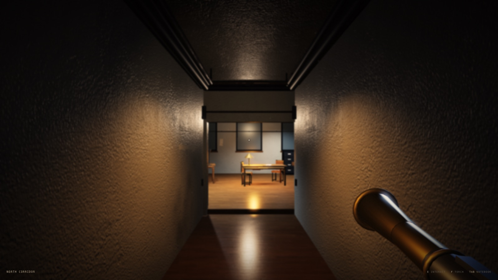
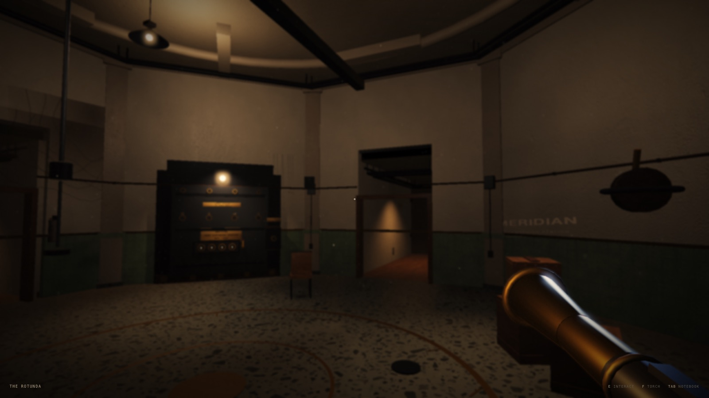
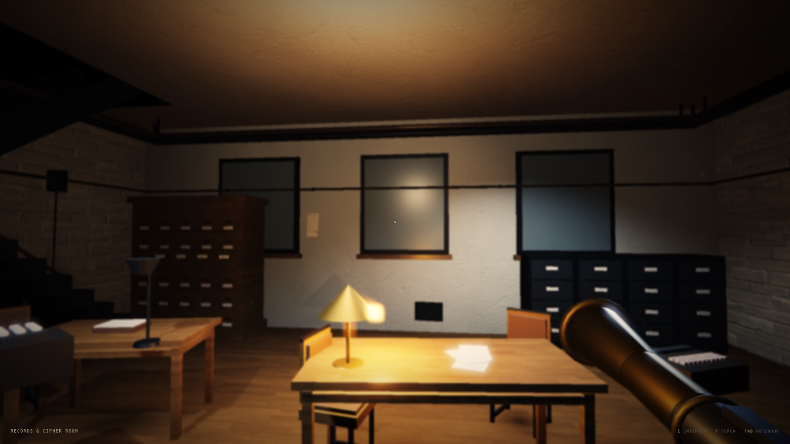
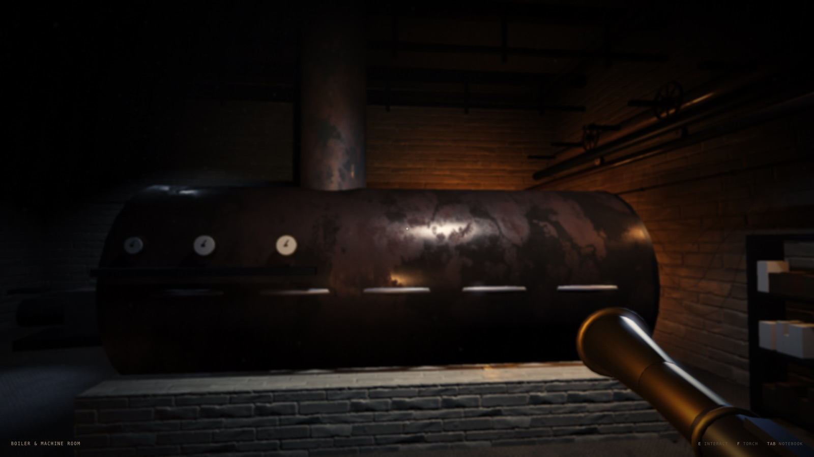
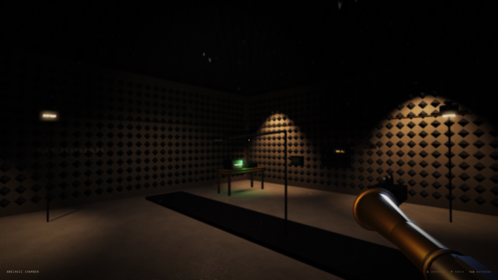
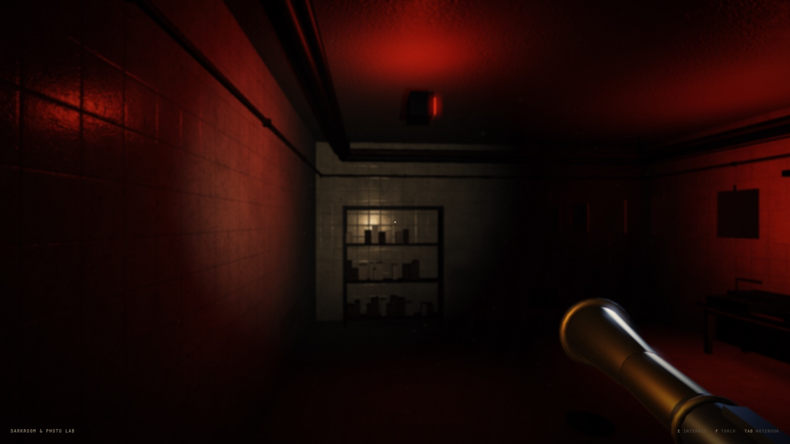
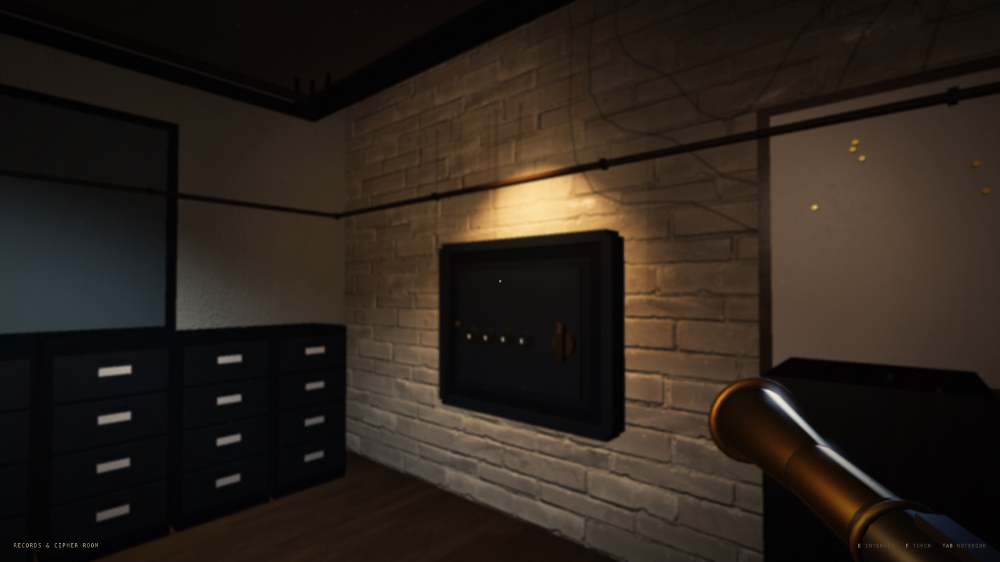
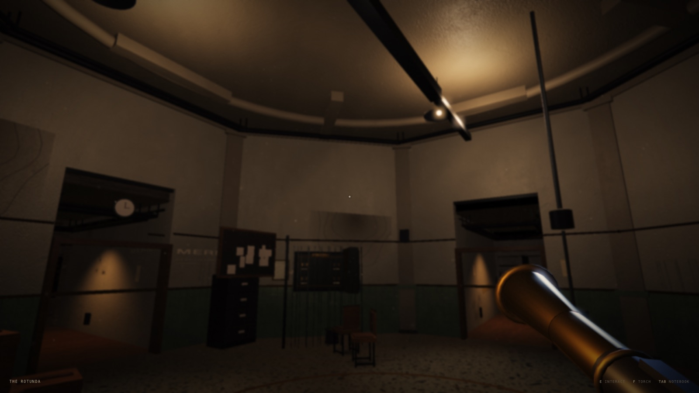

<div align="center">

# MERIDIAN

**A photoreal first-person escape room, running in a browser tab at 60 fps.**

<sub>Sealed in 1962. Four wings. One blast door. Nobody has come out of the rotunda since.</sub>

<br />

[](https://abhinav-prabhakar.github.io/MeridianStation/)

<br />


</div>



<div align="center"><sub><i>North corridor — baked bounce, tungsten practicals, no lightmaps, no bake-in of the player.</i></sub></div>

<br />

## The station

<table>
<tr>
<td width="50%"><br /><sub><b>THE ROTUNDA</b> — octagonal hub, 8 faces, one sealed door.</sub></td>
<td width="50%"><br /><sub><b>RECORDS & CIPHER</b> — card catalogue, wall safe, stair.</sub></td>
</tr>
<tr>
<td><br /><sub><b>BOILER & MACHINE</b> — four valves, four pressures, one order.</sub></td>
<td><br /><sub><b>ANECHOIC CHAMBER</b> — 601.6 Hz and a room that eats sound.</sub></td>
</tr>
<tr>
<td><br /><sub><b>DARKROOM</b> — developer, stop, fixer. Then turn on the light.</sub></td>
<td><br /><sub><b>THE SAFE</b> — four wheels, four digits, no forgiveness.</sub></td>
</tr>
</table>



<div align="center"><sub><i>The rotunda from the south door — conduit loop, junction boxes, the blast door lamp, and the dome stair beyond.</i></sub></div>

<br />

<table>
<tr>
<td align="center" width="25%"><h3>◈</h3><b>Nine rooms</b><br /><sub>rotunda, four wings, a dome, a tunnel</sub></td>
<td align="center" width="25%"><h3>⌘</h3><b>Four tokens</b><br /><sub>the plugs <i>are</i> the code display</sub></td>
<td align="center" width="25%"><h3>⏱</h3><b>60 fps</b><br /><sub>baked light, TAA, DoF, one post pass</sub></td>
<td align="center" width="25%"><h3>?</h3><b>Hints</b><br /><sub>4 stages × 3 tiers, never spoils</sub></td>
</tr>
</table>

<br />

## Controls

| | |
|---|---|
| <kbd>W</kbd><kbd>A</kbd><kbd>S</kbd><kbd>D</kbd> | walk · <kbd>Shift</kbd> to run · <kbd>Space</kbd> for stairs |
| <kbd>Mouse</kbd> | look — click the frame to lock the pointer |
| <kbd>E</kbd> | interact · **hold** to turn, crank, or pour |
| <kbd>F</kbd> | torch |
| <kbd>Tab</kbd> | notebook, objectives and hints |
| <kbd>Esc</kbd> | release the pointer |

<br />

## What is actually going on

Three.js, yes — but nothing else is off the shelf.

- **Lighting is not faked.** Every zone is baked in Blender 5.3 with Cycles into its own equirect HDR, then used as `scene.environment` and cross-faded as you cross a threshold. Direct lights and shadows still run live on top, so nothing is nailed to the floor.
- **A hand-written post chain, all of it.** SSAO at half res → two-scale bloom (a tight core at ¼, a wide haze at ⅛) → ACES → split-tone grade → vignette → **depth of field focused on the reticle** → **TAA with a sub-pixel Halton jitter and depth reprojection** → grain and chromatic aberration. No `postprocessing` package, no FXAA — temporal accumulation is what actually kills the edge shimmer.
- **Materials do the heavy lifting.** Real ambientCG photogrammetry, tinted through a custom shader that also multiplies in world-space grime, vertical runoff and a floor-level dirt band. That is why the plaster has water staining and the floor is dark where you walk.
- **Decals are drawn at runtime.** A 2048² canvas atlas of sixteen tiles — water damage, rust runs, drips, stencils, taped notes, mould, boot scuffs, a torn schematic — stamped onto walls *by raycast*, so they follow the geometry and never float. Every decal in the station merges into **one draw call**.
- **The station is plumbed.** Conduit loops, ceiling pipe bundles with hangers, junction boxes, drop cables and air bricks are generated from each room's own floor polygon, and the runs are cut where a doorway is — tested by firing a ray at the wall.
- **The air has something in it.** Dust motes wrap in a nine-metre cell around the camera, light shafts hang under the pendants and the dome slit, and the boiler vents steam. Additive geometry, three draw calls.
- **You have a body.** A brass hand lamp sits low-right in frame, bobbing with the walk cycle and lagging behind your look. It renders in its own scene stamped over the world with a cleared depth buffer — but inside the same post chain, so it is tonemapped and temporally resolved like everything else.
- **Everything is static-batched.** Thousands of props merge into a handful of geometry batches; the anechoic wedges and tunnel rivets are instanced.
- **The puzzles are physical.** Valves have pressure. The safe has wheels. The print is developed in a tray, under a safelight, by hand.

<br />

## The floor plan

```
                          ┌────────────────────────────────────────┐
                          │      RECORDS & CIPHER  (10 × 8)        │
                          │   card catalog · safe · tube station   │
                          │        ╔═══ STAIR ⌃ ═══╗               │
                          │        ║  OBSERVATION  ║  (above)      │
                          └────────╨──────┬────────╨───────────────┘
                                          │ N corridor
   ┌──────────────────┐          ┌────────┴────────┐          ┌───────────────────┐
   │   DARKROOM       │          │                 │          │  ANECHOIC         │
   │   & PHOTO LAB    │          │    ROTUNDA      │          │  CHAMBER          │
   │   (7 × 6)        ═══════════╡   r = 6.0 m     ╞══════════│  (9 × 9)          │
   │  safelight·trays │ W corr.  │  8 faces        │ E corr.  │  wedges·oscillo   │
   └────────┬─────────┘          │  patchboard     │          └───────────────────┘
            │ crawlspace         │  · exit NE ══╗  │
            │                     │  · fuse SW    │  │
   ┌────────┴─────────┐          └────────┬────────┘  │
   │  BOILER &        │                   │ S corridor│
   │  MACHINE ROOM    ═════════════════════╡           │
   │  (11 × 9)        │                   │           ╰──▶  BLAST DOOR
   └────────┬─────────┘                   │               (sealed, NE face)
            │                             │
   ╔════════╧══════════════════════════════════════════════╗
   ║  SUB‑LEVEL DRAINAGE TUNNEL (y = −3.4)  ~40 m of pipe   ║
   ╚═══════════════════════════════════════════════════════╝
```

<br />

## Run it

```bash
npm install
npm run dev      # http://localhost:5173
npm run build    # static bundle in dist/
```

No API keys, no backend, no analytics. Textures and HDRs live in `docs/` (~59 MB of assets, 219 kB of app code gzipped) — that folder *is* the published site, so a deploy is a build and a commit:

```bash
npm run deploy   # build → docs/ → push main
```

One branch. No CI. GitHub Pages serves `docs/` straight off `main`.

<details>
<summary><b>Re-bake the lighting</b> (Blender 5.3 + Cycles)</summary>

```bash
node scripts/receive.mjs &                       # receiver on :8788
open "http://localhost:5173/?bake=1"             # page exports zone probes
blender -b -P scripts/bake.py                    # writes docs/bake/*.hdr
```

`BAKE_W=1024 BAKE_H=512 BAKE_SAMPLES=96`. Roughly four minutes for all eleven zones.
</details>

<br />

<div align="center">
<sub>

**Assets** — ambientCG & Poly Haven photogrammetry (CC0), Blender Cycles bakes, everything else author-built.<br />
**Set in** a fictional acoustic-research bunker, 1962. Any resemblance to a real listening station is the point.

</sub>
</div>
